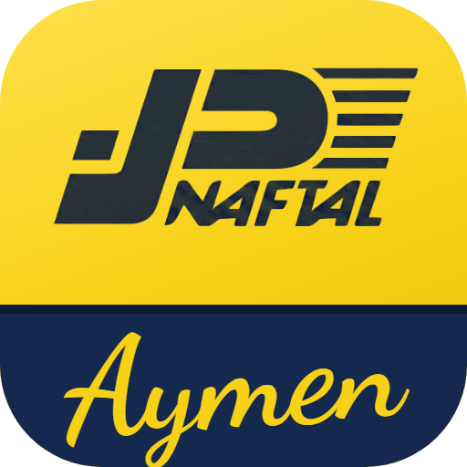
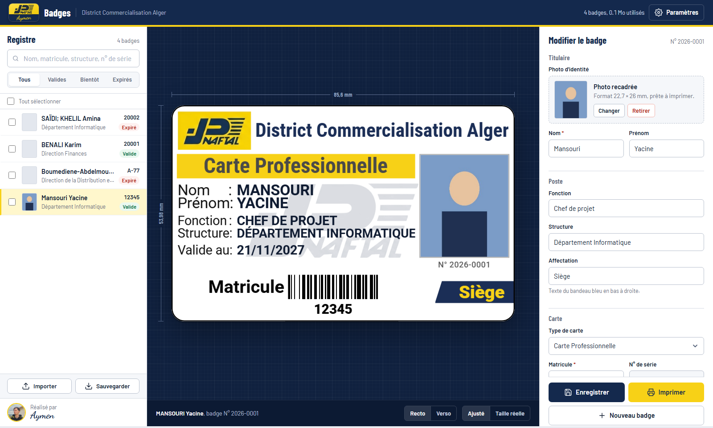
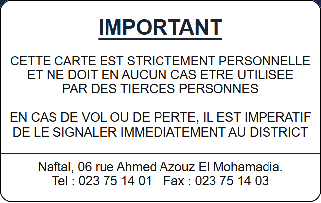

<p align="center"></p>

<h1 align="center">NAFTAL Badges</h1>

<p align="center">Générateur de cartes professionnelles (badges CR80) pour le District Commercialisation NAFTAL.<br>
Un seul fichier HTML, sans serveur, sans installation, fonctionne hors ligne.</p>

<p align="center"></p>

## Fonctionnalités

- **Badge CR80** (85,6 × 53,98 mm) fidèle au modèle officiel : logo, bandeau, photo, champs, code-barres Code 128 du matricule, bandeau d'affectation.
- **Verso** (« IMPORTANT ») modifiable dans les paramètres, avec aperçu animé recto/verso (retournement 3D).
- **Registre** enregistré dans le navigateur (IndexedDB) : recherche par nom, matricule, structure ou n° de série ; filtres *Valides / Bientôt / Expirés*.
- **Photo** : glisser-déposer, coller (Ctrl+V) ou parcourir, recadrage automatique au format 22,7 × 26 mm.
- **Impression** :
  - *Carte CR80*, une carte par page, pour imprimante à cartes PVC ;
  - *Planche A4*, 10 cartes par feuille avec traits de coupe ;
  - recto seul, recto + verso (verso miroir pour le recto-verso A4) ou verso seul.
- **Import / export** : CSV (Excel, séparateur `;`) et sauvegarde complète JSON (badges, photos, paramètres).
- Ajustement automatique des textes trop longs, avertissement si un texte est coupé.

<p align="center"></p>

## Utilisation

1. Ouvrez `naftal-badges.html` dans Chrome ou Edge.
2. Remplissez la fiche, ajoutez la photo, cliquez sur **Enregistrer**, puis **Imprimer**.
3. Dans la fenêtre d'impression : marges *Aucune*, échelle *100 %*, *Graphiques d'arrière-plan* activés.

> Les badges sont stockés dans le navigateur de l'ordinateur. Pour changer d'ordinateur ou de navigateur, exportez une **sauvegarde JSON** puis réimportez-la.

### Installation avec raccourci (Windows)

Le dossier [`installer/`](installer) contient `Installer.bat` : placez à côté `naftal-badges.html` (renommé `naftal-badges-pro.html`) et `naftal-badges.ico`, puis double-cliquez. L'outil est copié dans le profil utilisateur et un raccourci avec l'icône est créé sur le Bureau.

## Structure du projet

```
naftal-badges.html     application prête à l'emploi (générée)
naftal-badges.ico      icône Windows
src/template.html      code source (HTML, CSS, JS)
src/*.b64              images intégrées (logo, filigrane, icônes, photo du développeur)
src/build.py           assemble template + images -> naftal-badges.html
tests/test_app.py      tests de bout en bout (Playwright)
installer/             script d'installation Windows
docs/                  captures d'écran
```

## Développement

```bash
python src/build.py          # régénère naftal-badges.html
pip install playwright pypdf && python -m playwright install chromium
python tests/test_app.py     # 93 vérifications (rendu, code-barres, stockage, import/export, impression PDF…)
```

## Auteur

Réalisé par **Aymen**.

Le logo et la marque NAFTAL appartiennent à NAFTAL SPA ; ils sont utilisés ici uniquement pour les badges internes du district.
